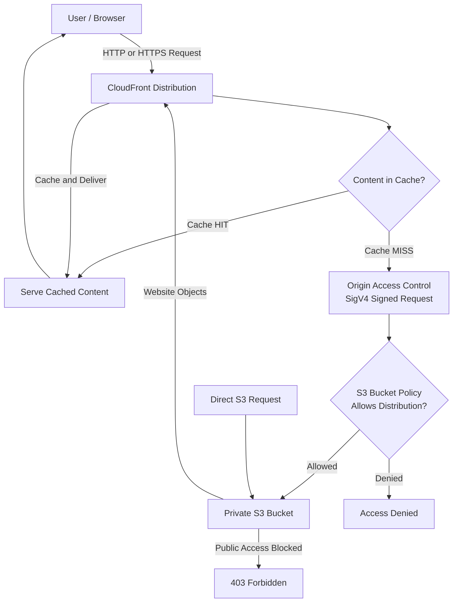
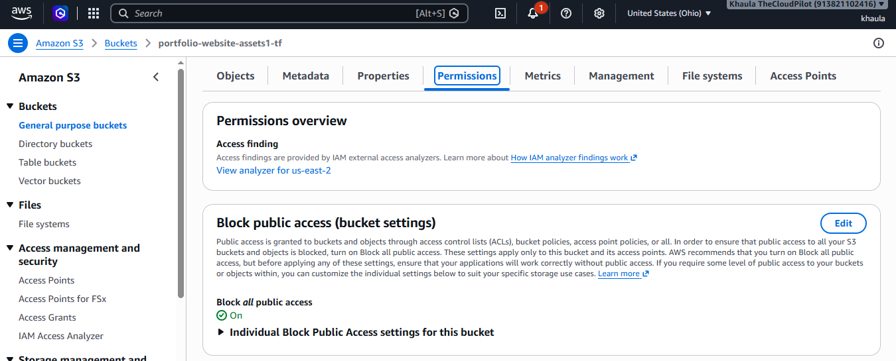
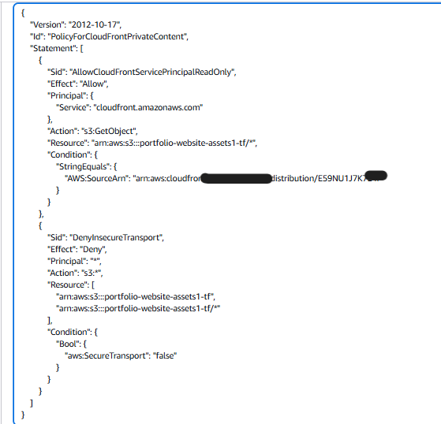
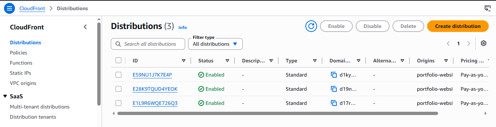
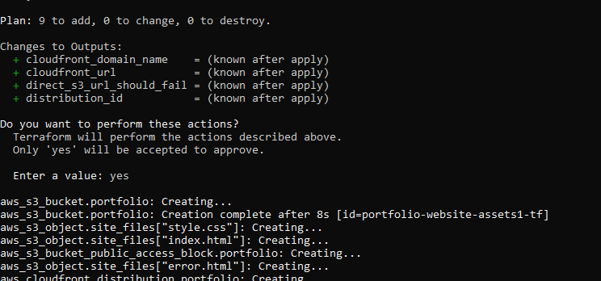

# 🔐 Secure Static Web Hosting and CDN Deployment on AWS

> A secure, globally distributed static website architecture using Amazon S3 and CloudFront, provisioned entirely with Terraform. The S3 bucket remains private, while CloudFront provides HTTPS delivery, caching, and controlled access through Origin Access Control (OAC).

## 📌 Project Overview

This project demonstrates how to deploy a static website on AWS without exposing the underlying S3 bucket to the public internet.

Instead of allowing users to access S3 directly, **CloudFront acts as the only entry point for content delivery**.

The architecture combines:

- **Amazon S3:** Private object storage for website files.
- **Amazon CloudFront:** CDN for global content delivery, caching, and HTTPS.
- **Origin Access Control (OAC):** Authenticated access between CloudFront and S3 using AWS Signature Version 4 (SigV4).
- **IAM Bucket Policy:** Restricts object access to a specific CloudFront distribution.
- **Terraform:** Provisions and manages the infrastructure as code.

The infrastructure was deployed, tested, verified, and subsequently destroyed to avoid ongoing charges.

---

## 🎯 Problem

Hosting a static website directly through a public S3 bucket creates unnecessary exposure.

A public bucket can allow users to bypass the intended content delivery layer and access objects directly.

This creates several concerns:

- Unrestricted access to stored objects.
- No centralized CDN delivery layer.
- Limited control over the intended access path.
- Inconsistent enforcement of secure transport.

The objective was to build an architecture where:

1. Website files remain private in S3.
2. Users access content through CloudFront.
3. CloudFront authenticates with S3 using OAC.
4. HTTP requests are redirected to HTTPS.
5. Unauthorized direct S3 requests are denied.

---

## 🏗️ Architecture

### Request and Data Flow



### How It Works

1. A user requests the website through the CloudFront distribution.
2. CloudFront checks whether the requested content is already cached.
3. If there is a cache hit, CloudFront delivers the cached content.
4. If there is a cache miss, CloudFront sends an authenticated request to S3 using OAC and SigV4.
5. The S3 bucket policy checks whether the request comes from the authorized CloudFront distribution.
6. S3 returns the requested object to CloudFront.
7. CloudFront caches the response and delivers the content to the user.

**Important security behavior:** Direct requests to the S3 bucket are denied. Users must access the website through CloudFront.

---

## ☁️ AWS Services & Their Responsibilities

| Component | Responsibility |
|---|---|
| Amazon S3 | Stores HTML, CSS, and website assets |
| CloudFront | CDN, caching, and HTTPS delivery |
| Origin Access Control | Authenticated CloudFront-to-S3 access |
| IAM Bucket Policy | Controls which distribution can retrieve objects |
| AWS Certificate Manager / CloudFront TLS | Supports encrypted HTTPS delivery |
| Terraform | Infrastructure provisioning and management |
| AWS CLI | AWS resource interaction and verification |

---

## 🔒 Security Architecture

Security was a primary design consideration rather than an additional configuration step.

### 1. Private S3 Bucket

The S3 bucket is not publicly accessible.

All four S3 Block Public Access settings are enabled.

This prevents public bucket policies and ACL configurations from exposing the stored content.

### 2. Origin Access Control (OAC)

CloudFront uses Origin Access Control to authenticate requests to the S3 origin.

OAC signs origin requests using AWS Signature Version 4.

The intended access path is:

```text
CloudFront Distribution
        |
        | Signed Request (SigV4)
        v
Private S3 Bucket
```

This avoids making the S3 bucket public just to serve website content.

### 3. Least-Privilege Bucket Policy

The S3 bucket policy allows only the configured CloudFront distribution to retrieve website objects.

The policy uses:

- `s3:GetObject` as the permitted action.
- The specific S3 bucket objects as the resource.
- `AWS:SourceArn` to restrict access to the intended CloudFront distribution.
- A condition denying requests that do not use secure transport.

Conceptually:

```text
Allow:
  Principal: CloudFront Service
  Action: s3:GetObject
  Resource: Bucket Objects
  Condition: Specific CloudFront Distribution ARN

Deny:
  Condition: aws:SecureTransport = false
```

This follows the principle of least privilege.

### 4. HTTPS Enforcement

CloudFront is configured to redirect HTTP requests to HTTPS.

```text
HTTP Request
     |
     v
CloudFront
     |
     v
301 Redirect
     |
     v
HTTPS Request
     |
     v
Website Content
```

This ensures that users access the website through an encrypted connection.

### 5. Encryption at Rest

S3 server-side encryption using AES-256 is enabled to protect stored website objects.

### 6. Versioning

S3 bucket versioning is enabled to retain previous object versions and support recovery from accidental overwrites or deletions.

---

## ⚙️ CDN Configuration

CloudFront provides the content delivery layer between users and the private S3 origin.

The distribution uses:

- Origin Access Control.
- CachingOptimized cache policy.
- Compression enabled.
- HTTPS redirection.
- CloudFront edge caching.

### Why CloudFront?

Without a CDN, users would need to retrieve content directly from the storage origin.

CloudFront caches frequently requested content closer to users, helping reduce latency and repeated origin requests.

### Cache Verification

The project verified that CloudFront was caching content successfully.

The second request returned:

```text
X-Cache: Hit from cloudfront
```

This confirms that the requested content was served from the CloudFront cache rather than requiring another origin fetch.

---

## 📋 Requirements Mapping

| Requirement | Implementation |
|---|---|
| Isolated object storage | Private S3 bucket |
| Data protection | Versioning and AES-256 encryption |
| Public access restrictions | All four Block Public Access settings enabled |
| Controlled origin access | CloudFront OAC with SigV4 |
| Least-privilege access | Distribution-specific IAM bucket policy |
| Secure transport | Non-TLS requests explicitly denied |
| CDN caching | CloudFront CachingOptimized policy |
| Compression | Enabled on CloudFront |
| HTTPS | HTTP redirected to HTTPS |
| Custom domain support | Optional Terraform variables |
| Infrastructure automation | Terraform |

---

## 🧰 Tech Stack

- Amazon S3
- Amazon CloudFront
- Origin Access Control (OAC)
- AWS IAM
- Terraform
- AWS CLI
- WSL (Ubuntu)
- Bash
- Git / GitHub
- HTTPS / TLS
- AWS Signature Version 4

---

## 📂 Project Structure

```text
.
├── terraform/
│   ├── main.tf
│   ├── variables.tf
│   ├── outputs.tf
│   ├── providers.tf
│   └── policy-reference.json
│
├── website/
│   ├── index.html
│   ├── error.html
│   └── style.css
│
├── screenshots/
│   ├── sc1.PNG
│   ├── sc2.PNG
│   ├── sc3.PNG
│   ├── sc4.PNG
│   ├── sc5.PNG
│   └── sc6.PNG
│
├── verify.sh
└── README.md
```

---

## 🚀 Deployment

### Prerequisites

- AWS account
- AWS CLI configured with appropriate permissions
- Terraform installed
- WSL with Ubuntu or another supported Linux environment

### Step 1: Initialize Terraform

```bash
cd terraform
terraform init
```

### Step 2: Review Infrastructure Plan

```bash
terraform plan
```

### Step 3: Deploy Infrastructure

```bash
terraform apply
```

Review and approve the Terraform deployment.

### Step 4: Verify Deployment

Return to the project root and execute:

```bash
cd ..
./verify.sh
```

The verification script checks the expected security and CDN behavior.

### Step 5: Clean Up Resources

After testing, destroy the infrastructure:

```bash
cd terraform
terraform destroy
```

This prevents unnecessary ongoing AWS charges.

---

## 📸 Deployment Evidence & Results

The following screenshots document the actual deployment and verification process.

### 1. S3 Bucket — Public Access Block Enabled

All four Block Public Access settings are enabled.



### 2. S3 Bucket Policy — CloudFront Only

The bucket policy restricts object retrieval to the authorized CloudFront distribution.



### 3. CloudFront Distribution

CloudFront is configured with OAC and HTTP-to-HTTPS redirection.



### 4. Terraform Deployment

Infrastructure provisioning completed successfully.



### 5. Security and CDN Verification

The verification script confirmed:

| Test | Expected Result | Actual Result |
|---|---|---|
| Direct S3 access | Blocked | 403 Forbidden |
| CloudFront access | Successful | 200 OK |
| HTTP request | Redirected to HTTPS | Verified |
| Second CDN request | Cache hit | Verified |


**What this proves:**

- The S3 bucket cannot be accessed directly.
- CloudFront can retrieve content through OAC.
- Website content is delivered successfully through the CDN.
- HTTP requests are redirected to HTTPS.
- CloudFront caching is functioning.

### 6. Live Website

The website was successfully delivered through the CloudFront HTTPS endpoint during testing.


---

## 💰 Cost Management

The architecture was designed to keep testing costs low.

Cost-conscious decisions included:

- No Route 53 hosted zone.
- No purchased custom domain.
- No additional compute instances.
- Use of AWS Free Tier where eligible.
- Destroying all provisioned resources after verification.

A zero-spend AWS Budget alert was also configured.

**Important:** AWS Free Tier eligibility and actual charges depend on account status, service usage, and applicable pricing. Always review your billing dashboard.

The infrastructure was destroyed after testing to avoid ongoing charges.

---

## ⚠️ Limitations & Future Improvements

The project demonstrates a working static website delivery architecture, but there are opportunities to extend it.

| Current Limitation | Possible Improvement |
|---|---|
| Default CloudFront domain | Configure a custom domain |
| No WAF protection | Integrate AWS WAF |
| No CDN access logging | Enable CloudFront access logs |
| Manual deployment | Build a CI/CD pipeline |
| Manual cache invalidation | Automate invalidation after deployment |

### Custom Domain Support

The Terraform configuration includes optional variables:

- `domain_name`
- `acm_certificate_arn`

These allow custom domain integration without changing the core architecture.

The feature was intentionally left disabled to avoid additional domain and DNS costs.

For a custom CloudFront domain, the ACM certificate must be provisioned in `us-east-1`.

### CI/CD Integration

A future improvement would be automating website deployments through GitHub Actions.

A possible workflow:

```text
Developer Push
      |
      v
GitHub Repository
      |
      v
GitHub Actions
      |
      v
Upload Website to S3
      |
      v
CloudFront Invalidation
      |
      v
Updated Website
```

---

## 🎯 Skills Demonstrated

**AWS Architecture**
- Static website hosting
- Object storage architecture
- CDN integration
- CloudFront origin configuration

**Security**
- S3 Block Public Access
- IAM bucket policies
- Least-privilege access
- Origin Access Control
- SigV4 authentication
- HTTPS enforcement
- Encryption at rest

**Infrastructure as Code**
- Terraform
- Resource provisioning
- Variable-driven configuration
- Infrastructure cleanup

**Troubleshooting & Verification**
- AWS CLI
- HTTP status verification
- CDN cache validation
- Direct origin access testing
- Deployment evidence collection

**Cost Awareness**
- Free Tier-conscious design
- Resource cleanup
- AWS Budget alerts

---

## 💡 Key Engineering Decisions

### Why keep S3 private?

Making S3 public would allow users to bypass CloudFront. Keeping it private ensures that content delivery happens through the intended access layer.

### Why use OAC instead of a public bucket policy?

OAC authenticates CloudFront's requests to S3, allowing the bucket to remain private while still serving website content globally.

### Why use a distribution-specific bucket policy?

Restricting access using `AWS:SourceArn` prevents other CloudFront distributions from using the same permission.

### Why use Terraform?

The infrastructure can be reviewed, recreated, modified, and destroyed through version-controlled configuration rather than relying on manual console operations.

---

## 📌 Project Status

| Item | Status |
|---|---|
| Terraform infrastructure | Completed |
| Private S3 bucket | Verified |
| Block Public Access | Verified |
| CloudFront OAC | Verified |
| Distribution-specific bucket policy | Verified |
| HTTPS redirection | Verified |
| CDN caching | Verified |
| Direct S3 access restriction | Verified |
| Deployment cleanup | Completed |
| Custom domain | Not deployed |
| CI/CD pipeline | Future improvement |

<sub>The CloudFront distribution is currently offline because all infrastructure was destroyed after testing.</sub>

---

## 👩‍💻 Author

**Khaula Azhar**

Cloud Engineering | AWS | Terraform | Infrastructure as Code

[GitHub](https://github.com/Khaula-cloud) · [LinkedIn](https://www.linkedin.com/in/khaula-azhar/)
