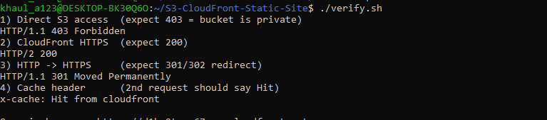
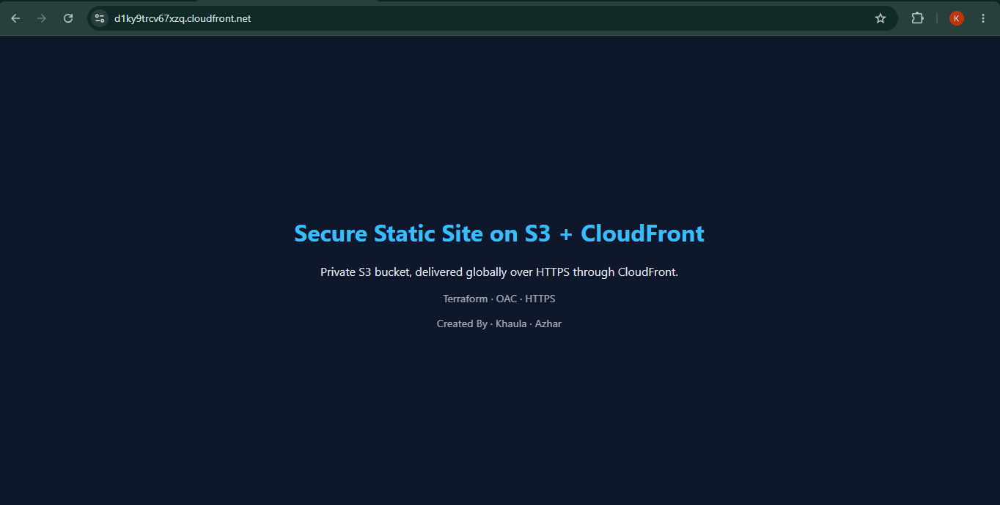

# Secure Static Web Hosting and CDN Deployment on AWS

A private Amazon S3 bucket served globally through CloudFront over HTTPS, provisioned entirely with Terraform.

```
User --HTTPS--> CloudFront (CDN cache + SSL) --OAC (SigV4)--> PRIVATE S3 bucket
```

## Objective

Deploy a globally available static website inside an object storage network, with restricted public access, a CDN cache layer and SSL encryption.

## Requirements mapping

| Requirement | Implementation |
|---|---|
| Isolated object storage | Private S3 bucket with versioning and AES-256 encryption at rest |
| Granular public access restrictions | All four S3 Block Public Access settings enabled |
| JSON IAM policy | Bucket policy allows only this CloudFront distribution (`AWS:SourceArn` condition) to `s3:GetObject`, and denies all non-TLS requests |
| CDN cache layer | CloudFront with the CachingOptimized policy and compression |
| SSL encryption | HTTP redirected to HTTPS, TLS certificate from CloudFront |
| Custom domain mapping | Supported through optional `domain_name` and `acm_certificate_arn` variables (left disabled to avoid domain and Route 53 cost) |

## Tech stack

AWS S3, CloudFront, Origin Access Control, IAM bucket policy, Terraform, WSL (Ubuntu), AWS CLI

## Project structure

```
.
├── terraform/       main.tf, variables.tf, outputs.tf, providers.tf, policy-reference.json
├── website/         index.html, error.html, style.css
├── screenshots/     deployment evidence
├── verify.sh        security and CDN verification script
└── README.md
```

## How to deploy

```bash
cd terraform
terraform init
terraform plan
terraform apply
cd .. && ./verify.sh
```

Destroy everything afterwards to avoid charges: `terraform destroy`

## Results

### 1. Bucket is private (Block Public Access ON)


### 2. JSON bucket policy (CloudFront only)


### 3. CloudFront distribution (OAC, HTTPS redirect)


### 4. Terraform apply


### 5. Verification: direct S3 blocked, CDN works
Direct S3 access returned **403**, CloudFront returned **200**, HTTP redirected to HTTPS, and the second request showed a cache **Hit**.


### 6. Live site over HTTPS


### 7. Cleanup
All resources were destroyed after testing to keep cost at zero.
-Run Terraform Destroy

## Security highlights

- No public bucket access. Content is reachable only through CloudFront.
- Least-privilege policy limited to one distribution and one action (`s3:GetObject`).
- Encryption in transit (HTTPS enforced) and at rest (AES-256).
- Versioning enabled for recovery.

## Cost

Designed to stay within the AWS Free Tier: no Route 53 and no purchased domain. The stack was destroyed after testing, and a zero-spend AWS Budget alert was configured.

## Limitations and future improvements

- The live URL is offline because the stack was destroyed to avoid cost.
- Custom domain with Route 53 and ACM is supported in code but was not deployed.
- Possible additions: AWS WAF, CloudFront access logging, a CI/CD pipeline.

## Author

Khaula Azhar
